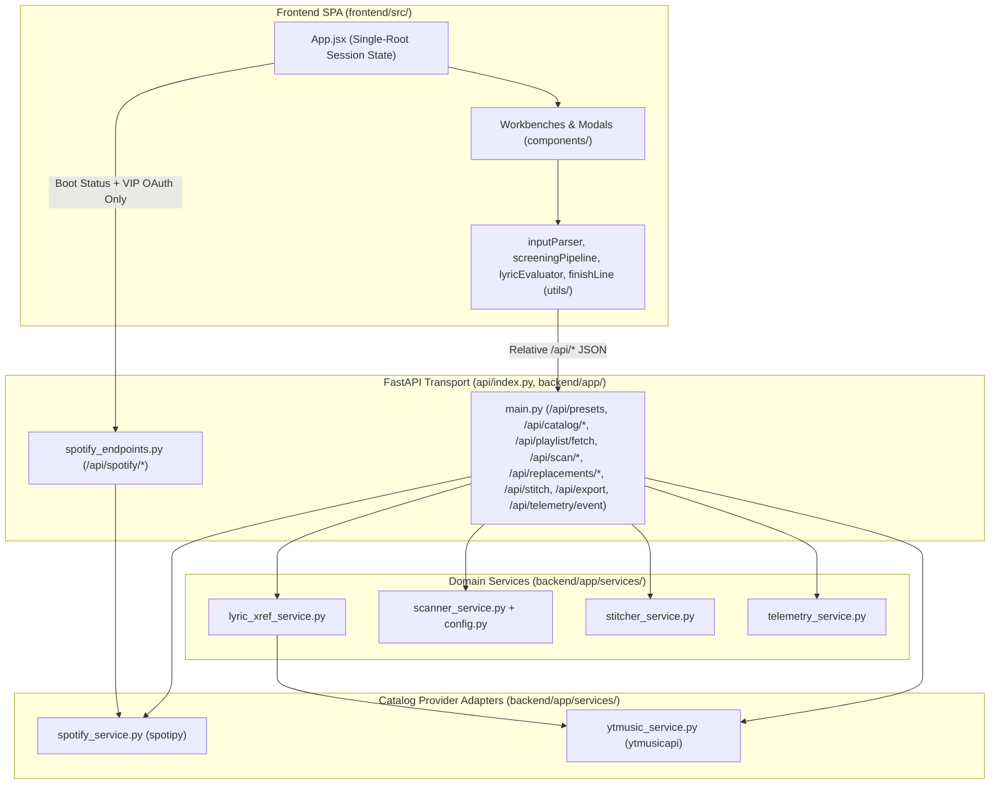
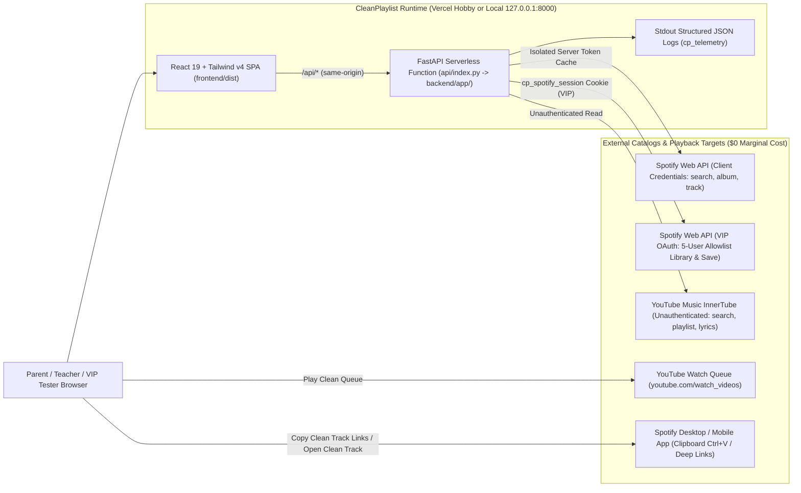
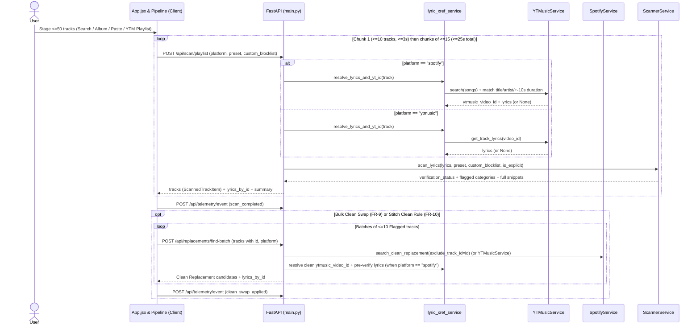

# Architecture Spine — CleanPlaylist (Public Launch Milestone)

## Design Paradigm

**Stateless Layered Backend-for-Frontend (BFF) with Provider-Adapter Services & Single-Root Unidirectional SPA State.**

- **Workbench UI (`frontend/src/`):** Single-root state container (`App.jsx`) owns canonical session state (**Active Platform**, **VIP Mode**, `isAuthenticated`, **Working List**, `keptTrackIds`, `sourcePlaylist`, `lyricsByTrackId`, `presetRules`, **Sensitivity Preset**, **Custom Blocklist**) and passes read-only slices + mutation callbacks down to tab workbenches/modals (`frontend/src/components/`) and pure client helpers (`frontend/src/utils/`). **Stitch Studio** (`StitchTab.jsx`) manages its own independent input pool and isolated stitched result state without mutating `App.jsx.workingList`. Zero direct browser-to-Spotify/InnerTube API calls; external playback/copy handoffs (**Clean Queue**, **Clean Track Link**) construct canonical URLs client-side.
- **HTTP Transport Boundary (`api/index.py`, `backend/app/main.py`, `backend/app/spotify_endpoints.py`):** FastAPI routers + Pydantic v2 schemas validate payloads, enforce batch caps, route by `platform`, and translate upstream exceptions (`spotipy.SpotifyException`, HTTP timeouts) into typed HTTP responses (`400`, `401`, `403`, `429`, `502`). Contains zero regex, merge, or provider-parsing logic.
- **Domain Services (`backend/app/services/scanner_service.py`, `stitcher_service.py`, `lyric_xref_service.py`, `telemetry_service.py`):** Deterministic lyric/keyword evaluation (`app/config.py`), **Lyric Cross-Reference** orchestration, multi-source stitching/export, and schema-locked **Usage Event** emission. Never import `spotipy` or `ytmusicapi` directly (`lyric_xref_service` calls `YTMusicService` through its normalized interface).
- **Catalog Provider Adapters (`backend/app/services/spotify_service.py`, `ytmusic_service.py`):** Encapsulate SDK clients, isolated server-side credential caching, HMAC `cp_spotify_session` cookie handling, `5s` per-call socket timeouts, rate-limit translation, and normalization into canonical track/album/playlist envelopes.



## Invariants & Rules

### AD-1 — Dual-Credential Spotify Split & VIP Mode 3-State Lifecycle [ADOPTED]

- **Binds:** `FR-1`, `FR-3`, `FR-4`, `FR-8`, `FR-9`, `FR-10`, `FR-14`, `NFR-5`, `SM-2`
- **Prevents:** Public catalog calls failing with `HTTP 401`, `HttpOnly` `cp_spotify_session` cookies failing to unlock **VIP Mode** on boot, cross-contaminating public vs. user token caches, non-allowlisted users hitting unhandled `500` OAuth errors, or invited VIP users hitting an onboarding deadlock when pasting Spotify playlists.
- **Rule:** `SpotifyService` separates `get_catalog_client()` (process-cached `spotipy.Spotify` backed by a dedicated isolated `SpotifyClientCredentials(cache_handler=MemoryCacheHandler())` using server-only `SPOTIFY_CLIENT_ID` / `SPOTIFY_CLIENT_SECRET`, removing legacy `.spotify_caches` disk paths) from `get_oauth_client(request, response)` (HMAC-SHA256 `cp_spotify_session` cookie, keeping `get_client` as a delegating alias for existing unit tests). Catalog search, album fetch, track lookup, and **Clean Replacement** routes use `get_catalog_client()` exclusively. `get_oauth_client()` is restricted to `/api/spotify/playlists`, `/api/spotify/playlist/save`, and `/api/playlist/fetch` (`platform == "spotify"`). On boot, `App.jsx` calls `GET /api/spotify/status` (`200 {"authenticated": bool}`, never `401`/`403`); **VIP Mode** activates iff `?vip=1` (`VIP_QUERY_PARAM`, persisted in `localStorage["cp_vip_mode"]`) OR `authenticated == True`. `/api/spotify/callback` verifies `sp.me()` before setting `cp_spotify_session`, redirecting non-allowlisted `403` accounts to `/?auth_error=allowlist_blocked&platform=spotify` so `GlobalHeader` renders a rose `role="alert"` `NoticeBanner` with 1-click `Exit VIP Mode` (which clears `localStorage["cp_vip_mode"]`, calls `POST /api/spotify/logout`, and strips `?vip=1` / `?auth_error` URL params).
  - **3-State Spotify Playlist URL Lifecycle:** (1) If `!vipMode`: input is intercepted client-side (`0` network calls) into `SpotifyPlaylistHelper` with public manual copy instructions; (2) If `vipMode && !isAuthenticated`: input triggers `SpotifyAuthModal` with a clear CTA (*"Connect Spotify to import your playlist"*); (3) If `vipMode && isAuthenticated`: input routes to `POST /api/playlist/fetch`. `YTMusicService` remains strictly unauthenticated (`YTMusic()`).

### AD-2 — Spotify Feb-2026 Development Mode Quota & Endpoint Adaptation [ASSUMPTION]

- **Binds:** `FR-1`, `FR-3`, `FR-4`, `FR-8`, `FR-9`, `FR-10`, `NFR-1`, `NFR-2`
- **Prevents:** Calling plural batch endpoints removed for Development Mode apps in Spotify's Feb-2026 Web API update (`GET /v1/tracks`, `GET /v1/albums`), passing `limit > 10` to `GET /v1/search`, swallowing `SpotifyException` status codes as `500`/empty results, or crashing on non-owned third-party Spotify playlists.
- **Rule:** *(Supersedes plural `GET /v1/tracks?ids=...` mechanism notes in `PRD NFR-2`, `addendum.md` §2.1, and `EXPERIENCE.md`.)* `SpotifyService` enforces `limit <= 10` on all `sp.search()` calls, loads albums via `GET /v1/albums/<id>` + `GET /v1/albums/<id>/tracks` (`limit=50`), and resolves pasted Spotify track URLs via singular `GET /v1/tracks/<id>` (`sp.track()`) backed by a process-level TTL cache (`maxsize=512`, `ttl=3600s`) and `ThreadPoolExecutor(max_workers=4)` inside client chunks of `<= 15` lines. `SpotifyException` status codes (`401`, `403`, `429`) are preserved verbatim: upstream `429` responses (including `reason: "QUOTA_EXCEEDED"`) propagate as `HTTP 429` with `{"detail": "<msg>", "retry_after": <int>}`, and in **VIP Mode**, `HTTP 403` on `/api/playlist/fetch` (Spotify's Feb-2026 non-owned/non-collaborative playlist restriction) routes gracefully on the client to `SpotifyPlaylistHelper`.

### AD-3 — Canonical Track Schemas, Self-Swap Guard, & Zero False-Clean State Machine [ADOPTED]

- **Binds:** `FR-1`..`FR-13`, `NFR-3`, `SM-C1`
- **Prevents:** `TrackScanItem` stripping scan verdict details, round-trip HTTP `422` schema crashes, non-explicit lyric-flagged tracks matching *themselves* as **Clean Replacements**, or failed lyric lookups masquerading as `Verified Clean`.
- **Rule:** The system defines two distinct, typed envelopes:
  1. `TrackScanItem(BaseModel)` (Canonical 12-key envelope): `id`, `title`, `artist`, `artists_list`, `album`, `duration`, `duration_seconds`, `is_explicit`, `thumbnail`, `video_url`, `ytmusic_video_id: Optional[str]`, and `verification_status: Literal["unscanned", "verified_clean", "flagged", "clean_swapped", "lyrics_unavailable"]` (with optional `setVideoId` on `ytmusic`). Configured with `extra="ignore"` so previously scanned tracks passed into batch endpoints do not fail validation.
  2. `ScannedTrackItem(TrackScanItem)` (Enriched scan verdict envelope): explicitly returns `is_flagged: bool`, `reasons: List[str]`, `snippets: List[Dict[str, Any]]`, `detected_terms: List[Dict[str, Any]]`, and `total_flagged_count: int`. Emitted by `/api/scan/playlist` and `/api/scan/track-lyrics`.
  Both `search_clean_replacement` adapters require `exclude_track_id` and reject any candidate where `candidate["id"] == exclude_track_id`. **Zero False-Clean Invariant (`NFR-3`):** Staged tracks initialize as `"unscanned"`. Post-scan status becomes `"verified_clean"` *if and only if* `has_lyrics == True` AND `total_flagged_count == 0` AND (`not include_metadata_explicit or not is_explicit`). Whenever `has_lyrics == False` (timeout, miss, empty lyric body), status resolves to `"flagged"` (with `reasons` containing both `"Marked Explicit by <Platform>"` and `"Lyrics Unavailable"`) when `include_metadata_explicit and is_explicit`, else `"lyrics_unavailable"` — never `"verified_clean"`. Applying a **Clean Replacement** sets `verification_status = "clean_swapped"` and `is_flagged = False` *only after* verifying the clean replacement's lyrics or non-explicit status.

### AD-4 — Unified Backend API Surface & Platform-Explicit Payloads [ADOPTED]

- **Binds:** `FR-1`..`FR-15`, `NFR-1`, `NFR-2`
- **Prevents:** Parallel epics inventing duplicate routes, omitting `platform`, calling deprecated Spotify playlist endpoints, double-appending `" (Clean)"` on Spotify saves, missing `> 50` YTM playlist truncation counts, or failing on Spotify inside `LyricsModal`, **Stitch Studio**, and exports.
- **Rule:** Every frontend `/api/*` call uses a relative URL and explicitly sends `platform: activePlatform` (where applicable). `GET /api/presets` returns `PRESET_PROFILES`, `WORD_CATEGORIES`, and morphological suffix rules (`(?:ing|ed|s|es)?`) so client and server evaluation stay 100% synchronized.
  - *Ratified + aligned routes:*
    - `GET /api/health`; `GET /api/presets`.
    - `POST /api/playlist/fetch`: enforces explicit `tracks[:limit]` slicing (`limit=50` in public mode) and returns `source_track_count: int` + `truncated: bool` alongside `tracks`.
    - `POST /api/scan/playlist`: `<= 15` tracks/req, `deep_scan_lyrics: bool = True` default, un-truncated `snippets` per track, and top-level `lyrics_by_id: Dict[str, str]` alongside `{tracks: ScannedTrackItem[], summary}`.
    - `POST /api/scan/track-lyrics`: accepts `{video_id, title, artist, duration_seconds, ytmusic_video_id, is_explicit, preset, custom_blocklist, platform}`.
    - `POST /api/scan/keywords`: accepts `<= 15` uncached tracks per chunk (or client evaluates `lyricsByTrackId` locally via `lyricEvaluator.js`) and includes `lyrics_unavailable_count: int` in `summary`.
    - `POST /api/replacements/find`: accepts `track_id: Optional[str] = None` (self-swap guard), co-resolves clean `ytmusic_video_id` on `spotify`, and returns candidate track lyrics into `lyrics_by_id`.
    - `POST /api/stitch`: accepts `StitchRequest = {playlists: List[Dict], order_mode, deduplication_mode, clean_mode, manual_replacements: Dict[str, Dict], manual_actions: Dict[str, str], platform}` where `playlists` holds original tracks and `manual_replacements` is keyed by original `track.id`. Returns standalone `StitchResult = {tracks: ScannedTrackItem[], summary: StitchSummary}`. Checks `verification_status == "flagged"` (falling back to `is_flagged` only when unset), stamps `verification_status = "clean_swapped"` on replaced items, and preserves `source_playlist_title`.
    - `POST /api/export`: adds `platform`, uses `"Track Link"` CSV header, and writes canonical `video_url` in M3U8/CSV/JSON.
    - `/api/spotify/*`: `GET /api/spotify/playlists` (`limit=20, offset` -> `{items, total, limit, offset, has_next, has_prev}`); `POST /api/spotify/playlist/save` uses `SpotifySaveRequest = {original_playlist_id: Optional[str] = None, playlist_title: str, final_track_ids: List[str], create_new: bool = True, is_public: bool = False}` (client owns default `<Title> (Clean)` string; backend uses `playlist_title` verbatim on `create_new=True` calling `sp.current_user_playlist_create(name=req.playlist_title, public=req.is_public, description=...)`, passes `public=req.is_public`, chunks writes per `100` URIs, handles all 3 playlist item shapes + `None` guard on read, and raises HTTP errors on `create_new=False` failure rather than silently creating a duplicate playlist).
  - *New fixed routes:*
    - `POST /api/catalog/search`: `{query, platform, limit<=10}` -> `{songs: TrackScanItem[], albums: AlbumSummary[]}` where `AlbumSummary = {id, title, artist, thumbnail, track_count: Optional[int]}`.
    - `POST /api/catalog/album`: `{album_id, platform}` -> `{id, title, artist, thumbnail, track_count, tracks: TrackScanItem[]}`.
    - `POST /api/catalog/resolve`: `{lines: str[] (<=15), platform}` -> `{resolved: TrackScanItem[], unresolved: {line, reason: Literal["wrong_platform", "not_found", "invalid_url"]}[]}` (same-platform track URLs resolve via exact ID — `sp.track()` on `spotify`, `yt.get_watch_playlist(video_id)` metadata on `ytmusic`; cross-platform URLs skip immediately with `reason="wrong_platform"`; plain text resolves via top catalog song match).
    - `POST /api/replacements/find-batch`: `{tracks: {id, title, artist, duration_seconds}[] (<=10), platform}` -> `{results: Record<track_id, TrackScanItem | null>, lyrics_by_id: Dict[str, str]}`.
    - `POST /api/telemetry/event`: `UsageEventPayload` -> `202 {"ok": true}`.

### AD-5 — Single Lyric Cross-Reference Owner & Dual-Tier Lyric Evaluation [ADOPTED]

- **Binds:** `FR-5`, `FR-6`, `FR-7`, `FR-10`, `FR-11`, `SM-3`, `SM-C1`
- **Prevents:** Divergent Spotify-to-YouTube matching rules across tabs, wrong remix/cover matches, cold serverless instances losing cached lyrics between preset toggles or `Keyword Search`, or re-fetching already-resolved lyrics.
- **Rule:** `lyric_xref_service.resolve_lyrics_and_yt_id(track, platform)` is the sole server lyric-resolution entry point across `/api/scan/playlist`, `/api/scan/track-lyrics`, and `/api/scan/keywords`. On `ytmusic`, `ytmusic_video_id = track.id`. On `spotify`, if `track.ytmusic_video_id` is unset, it queries `YTMusicService` (`filter="songs"`, `limit=5`) requiring normalized title + primary artist match AND `abs(yt_duration - track.duration_seconds) <= 10` when both durations `> 0` (top normalized song fallback only when duration metadata is `0`). Resolved `(ytmusic_video_id, lyrics)` pairs are cached in `YTMusicService` (`maxsize=512`) and returned via `/api/scan/playlist`'s `lyrics_by_id` into `App.jsx`'s `lyricsByTrackId`. Client `lyricEvaluator.js` hydrates `GET /api/presets` once (incorporating morphological suffix rules `(?:ing|ed|s|es)?`) so **Sensitivity Preset** toggles, **Custom Blocklist** edits, `LyricsModal` line highlighting/jumpers, and `Keyword Search` over already-cached tracks execute instantaneously in memory (`0` network calls) with byte-for-byte verdict parity to server scanning. On in-memory preset changes, `lyricEvaluator.js` triggers `POST /api/telemetry/event (scan_completed)` to keep conversion funnels accurate. Calling chunked backend endpoints is restricted strictly to tracks missing from `lyricsByTrackId`.

### AD-6 — Client-Driven Progressive Chunking, Timeouts, & Shared Screening Pipeline (OQ-2) [ASSUMPTION]

- **Binds:** `FR-5`, `FR-7`, `FR-9`, `FR-10`, `FR-11`, `NFR-1`, `NFR-2`
- **Prevents:** Missing `<= 3s` initial render or `<= 25s` 50-track completion SLOs, hung upstream sockets breaching `< 8s` p95 per-request limits, 50 uncoordinated single-track replacement calls tripping `HTTP 429`, or **Stitch Studio** dropping/keeping tracks without **Lyric Cross-Reference** or `manual_replacements` populated.
- **Rule:** Provider HTTP calls enforce a `5s` per-request timeout. Shared client `screeningPipeline.js` drives chunked execution across `Scan & Clean`, `Keyword Search` (for uncached tracks), and **Stitch Studio**: (1) `/api/scan/playlist` dispatches an initial batch of `<= 10` tracks (rendering first verdicts in `<= 3s`) followed by `<= 15`-track batches (`ThreadPoolExecutor(max_workers=6)` server-side, completing 50 tracks in `<= 25s`); (2) bulk **Clean Replacement** (`FR-9` and **Stitch Studio** `replace_clean_or_*` modes) calls `POST /api/replacements/find-batch` in batches of `<= 10` `Flagged` tracks (`ThreadPoolExecutor(max_workers=4)` server-side, co-resolving clean `ytmusic_video_id` and pre-verifying clean lyrics on `spotify`); (3) in **Stitch Studio**, `screeningPipeline.js` reuses `App.jsx` `lyricsByTrackId` for `Add Current Working List` tracks, maps non-null `find-batch` results into `StitchRequest.manual_replacements` (keyed by original track ID, preserving `manual_actions`), and calls `POST /api/stitch`. On `HTTP 429` or `5xx`, the pipeline halts cleanly, retains completed chunks in memory, and surfaces a `role="alert"` `NoticeBanner` whose `Retry` action resumes from the first incomplete chunk.

### AD-7 — Single-Root Session State, Ready-Track Predicate, & Stitch Tab Decoupling [ADOPTED]

- **Binds:** `FR-1`..`FR-4`, `FR-7`..`FR-12`, `FR-14`, `OQ-1`, `SM-C2`
- **Prevents:** Cross-platform state pollution on **Active Platform** switch, divergent Smart Input URL handling, undefined `Keep Flagged Track` / `FinishLineBar` ready-track filtering, silent empty **Clean Queue** tabs on Spotify, or **Stitch Studio** overwriting active scan staging in `workingList`.
- **Rule:** `App.jsx` owns `activePlatform` (`"spotify" | "ytmusic"`), `vipMode`, `isAuthenticated`, `workingList` (deduplicated by `track.id` with `"Already in Working List"` notice), `keptTrackIds` (`Set<str>` toggled by row/modal `Keep Flagged Track`, leaving `Flagged` badge intact), `sourcePlaylist` (`{id, title, canOverwrite} | null` controlling `SavePlaylistModal`'s overwrite option), `lyricsByTrackId`, `preset`, and `customBlocklist` (initialized to `[]`; `KeywordsTab` initializes starter chips `["money", "drugs", "party", "alcohol", "gun"]`).
  - **5-Way Smart Input (`inputParser.js`):** Routes (1) Spotify playlist URL/URI per AD-1's 3-state lifecycle; (2) YTM playlist URL -> `/api/playlist/fetch` on `ytmusic` or cross-platform switch `NoticeBanner` on `spotify`; (3) single track URL -> `/api/catalog/resolve` (`lines: [url]`) or cross-platform switch `NoticeBanner`; (4) multi-line `onPaste` (`\n`) -> `PasteTrackListPanel`; (5) single-line query -> `300ms` debounced `/api/catalog/search`.
  - **Atomic Platform Reset:** Any **Active Platform** switch (via `CatalogSelector` or cross-platform `NoticeBanner` CTA) while `workingList.length > 0` requires `PlatformSwitchModal` confirmation and atomically clears `workingList`, `keptTrackIds`, `sourcePlaylist`, `lyricsByTrackId`, replacement candidates, `Keyword Search` results, and **Stitch Studio** sources.
  - **50-Track Public Quota & Ready-Track Predicate:** Public mode caps staged tracks at `50` with an amber truncation `NoticeBanner` across all four entry paths (Song/Album add, `PasteTrackListPanel`, YTM playlist fetch, and **Stitch Studio** combined pool, which also supports 1-click `Add Current Working List`). `Scan & Clean` never auto-deletes unswappable `Flagged` tracks. In `Scan & Clean`, `FinishLineBar` defines `readyTracks` as `verification_status in {"verified_clean", "clean_swapped"} or id in keptTrackIds`.
  - **Stitch Studio Decoupling:** `StitchTab` hosts its own dedicated instance of `FinishLineBar` operating on `stitchedResult.tracks` without modifying `App.jsx.workingList`. On `spotify`, `finishLine.js` builds **Clean Queue** from non-null `ytmusic_video_id`s on `readyTracks`, emits an amber omitted-track `NoticeBanner` when partial `readyTracks` lack `ytmusic_video_id`, and blocks opening an empty `watch_videos` URL if `0` IDs resolved (`> 50` VIP queues render sequential `Queue 1-50`, `Queue 51-N` buttons).

### AD-8 — Obsidian Audio Core Token Contract, Finish-Line Inversion, & Accessibility Floor [ADOPTED]

- **Binds:** `FR-11`, `FR-12`, `NFR-4`, `DESIGN.md`, `EXPERIENCE.md`
- **Prevents:** Legacy `AGENTS.md` `green-600` / Tailwind v3 (`bg-slate-850`) classes leaking into builds, Stitch AI-hallucinated chrome/telemetry shipping to production, desktop/mobile CTA priority mismatches, or missing live-region/focus/label contracts breaking screen readers and React Testing Library.
- **Rule:** *(Supersedes legacy v1 `green-600` / Slate v3 guidance in `AGENTS.md`.)* `frontend/index.html` loads Google Fonts (`Plus Jakarta Sans` `400;500;600;700`, `JetBrains Mono` `400;500`), and `frontend/src/index.css` declares all `DESIGN.md` tokens under Tailwind CSS v4 `@theme` (`rounded-full` stays `9999px`; icons exclusively via `lucide-react`). Studio CTAs across both catalogs use `brand-primary` (`#7C3AED`); `status-clean` (`#4EDEA3` / `#10B981`) is reserved strictly for `Verified Clean`, `Clean Swapped`, and `Swap to Clean`; `status-caution` (`#FCD34D` / `#F59E0B`) owns `Lyrics Unavailable` and warning `NoticeBanner`s. `FinishLineBar` makes `Copy Clean Track Links` (with `Ctrl+V` / `Cmd+V` Spotify Desktop hint) primary on desktop `>= 768px` `Scan & Clean`, and inverts `Play Clean Queue` to primary on `< 768px` mobile and all **Stitch Studio** viewports. **Accessibility Floor:** Verbatim `aria-label`s per `EXPERIENCE.md` on every icon/input control; icon+text pairing on every `VerificationStatusBadge`; focus trap, `Escape` close, and trigger focus restoration on 1-level modals; `aria-live="polite"` on scan/swap/copy/dedup status updates and `role="alert"` on `HTTP 429` + VIP OAuth error `NoticeBanner`s; `44px` mobile tap targets at `>= 360px` with zero horizontal overflow; `prefers-reduced-motion: reduce` respected. Banned everywhere: Stitch shell clutter (bells, gears, avatars, `⌘K`, sidebars, `"Read-Only Mode"`), manual `"Deep Lyric Scan"` checkboxes/track-cap dropdowns, fabricated AI/broadcast metrics, and inline audio/iframe players.

### AD-9 — Locked Zero-PII Telemetry Schema & Per-Action Funnel Emission (OQ-3) [ASSUMPTION]

- **Binds:** `FR-15`, `NFR-5`, `SM-1`, `SM-2`, `SM-3`, `SM-4`, `SM-C1`
- **Prevents:** Progressive chunks multiplying `scan_completed` `4x`, `extra="forbid"` `422` mismatches across parallel stories, `SM-3` counting missing-lyric explicit tracks as lyric matches, missing client-only finish clicks, or leaking PII/queries/URLs/tokens.
- **Rule:** Each completed user funnel action emits **once** via `POST /api/telemetry/event` (`keepalive: true` / `sendBeacon`, plus optional `window.__CP_ANALYTICS_HOOK__`). `TelemetryService` validates a strict Pydantic v2 discriminated union (`extra="forbid"`) sharing base fields `{event, platform: Literal["spotify", "ytmusic"], viewport_class: Literal["mobile", "desktop"], vip_mode: bool, session_anon_id: str}` (`sessionStorage` random UUID) and exact per-event fields:
  1. `input_loaded`: `{input_type: Literal["song_search", "album_search", "pasted_list", "ytm_playlist", "vip_spotify_playlist", "working_list_import"], track_count_bucket: Literal["1-10", "11-25", "26-50", "51+"]}`
  2. `scan_completed`: `{preset_id: Literal["kid_safe", "moderate", "slurs_only", "custom"], track_count: int, flagged_count: int, lyrics_unavailable_count: int}` *(where `lyrics_unavailable_count` counts all tracks with `has_lyrics == False`, including explicit-flagged ones, so `SM-3` never inflates)*
  3. `clean_swap_applied`: `{mode: Literal["single", "bulk"], swapped_count: int, unfound_count: int}`
  4. `stitch_completed`: `{source_count: int, clean_rule: Literal["replace_clean_or_drop", "replace_clean_or_keep", "exclude_flagged", "keep_all"], output_count: int}`
  5. `finish_action_clicked`: `{action: Literal["play_clean_queue", "copy_clean_links", "open_track_link", "file_export", "vip_spotify_save"]}`
  Writes one JSON line `{"channel": "cp_telemetry", "schema_version": 1, ...}` to stdout (`\$0` Vercel Runtime Logs, with optional server-side forwarder gated by `TELEMETRY_INGEST_URL`). Unit tests assert rejection of raw queries, URLs, titles, blocklist words, emails, and tokens.

### AD-10 — Dual-Target Operational Envelope, Repo Hygiene, & Dual-Manifest Sync [ADOPTED]

- **Binds:** `NFR-1`, `NFR-5`, `AGENTS.md`
- **Prevents:** Vercel vs. local `run.py` routing drift, secret leakage into `VITE_*` client bundles, `localhost` Spotify OAuth rejection, unsynced `requirements.txt` files, stale `AGENTS.md` v1 rules misleading downstream build agents, or Windows `.vite-temp` `EPERM` test/build blocks.
- **Rule:** Vercel Hobby serves `frontend/dist` via CDN and rewrites `/api/(.*)` (`vercel.json`) to `api/index.py` (`maxDuration: 60`, Python pinned via new root `.python-version` file to `3.13`, zero database, `< 500 MB` bundle); locally, `run.py` serves FastAPI + `frontend/dist` on `http://127.0.0.1:8000` (never `localhost`) and Vite (`:5173`) proxies `/api` to `http://127.0.0.1:8000`. Runtime Python dependencies stay identical across root `requirements.txt` and `backend/requirements.txt`, with test-only deps (`pytest>=8.0.2`, `pytest-asyncio>=0.23.5`) in `backend/requirements.txt` only. `SPOTIFY_CLIENT_ID`, `SPOTIFY_CLIENT_SECRET`, `SESSION_SECRET_KEY` (canonical name in `spotify_service.py` and `backend/.env.example`), `SPOTIFY_REDIRECT_URI`, and optional `TELEMETRY_INGEST_URL` remain server-only with safe placeholders in `backend/.env.example`. Operational prerequisite: app owner's Spotify Developer account maintains active Spotify Premium.
  - **Foundation Migration Steps:** The initial foundation story: (1) creates root `.python-version` (`3.13`); (2) prunes unused `better-profanity>=0.7.0` from requirements and cleans `profanity.load_censor_words()` cold-start overhead; (3) refreshes `AGENTS.md` so `<user_rules>` reflect Obsidian Audio Core `@theme` tokens (`AD-8`), `lyric_xref_service` (`AD-5`), dual Spotify credentials (`AD-1`), and Windows `.vite-temp` read-only attribute workaround (`Remove-Item -Recurse -Force frontend\node_modules\.vite-temp` on `EPERM`).

## Consistency Conventions

| Concern | Convention |
| --- | --- |
| Naming & Verbatim Glossary | Python modules/functions/JSON fields: `snake_case`; Pydantic models & service classes: `PascalCase`; React components/files: `PascalCase.jsx` (`camelCase.js` in `utils/`). Code, UI copy, and docs use all 13 PRD §3 Glossary nouns verbatim: **Active Platform**, **Working List**, **Pasted Track List**, **Lyric Cross-Reference**, **Verification Status** (`Verified Clean`, `Flagged`, `Clean Swapped`, `Lyrics Unavailable`), **Clean Replacement**, **Sensitivity Preset**, **Custom Blocklist**, **Clean Queue**, **Clean Track Link**, **Stitch Studio**, **VIP Mode**, **Usage Event**. |
| Data & Envelopes | Playlist envelope: `id`, `title`, `description`, `author`, `track_count`, `source_track_count`, `truncated`, `thumbnail`, `tracks`. Album envelope: `id`, `title`, `artist`, `track_count`, `thumbnail`, `tracks`. Track envelope: 12-key contract per `AD-3` (scanned metadata returned via `ScannedTrackItem`, full lyrics travel via top-level `lyrics_by_id` on `/api/scan/playlist`). **Clean Queue**: `https://www.youtube.com/watch_videos?video_ids=<up-to-50-ids>`. **Clean Track Link**: `https://open.spotify.com/track/<id>` or `https://music.youtube.com/watch?v=<id>`, copied `\n`-joined with zero trailing spaces. |
| Errors & HTTP Statuses | FastAPI errors return `{"detail": "<calm evidence-first message>"}` (plus `"retry_after": <int>` on `429`). `400` validation/bad URL; `401` missing/expired VIP `cp_spotify_session` on VIP-only routes; `403` Spotify Dev Mode allowlist or non-owned playlist restriction; `429` upstream rate/quota limit; `502` upstream provider failure/timeout. Unresolved lines in **Pasted Track List** return `200` inside `unresolved[]`. |
| State, Config, & Auth | Session state lives in `App.jsx` memory (`localStorage` strictly for `cp_vip_mode="1"`, `sessionStorage` strictly for `session_anon_id`). `cp_spotify_session` cookie is `HttpOnly`, `SameSite=Lax`, `Secure` on HTTPS, zlib+HMAC-SHA256 signed via `SESSION_SECRET_KEY`. |
| Verification & TDD Discipline | Red-Green-Refactor TDD on `feature/<short-name>` or `fix/<short-name>` (never direct to `master`). Zero live network or real auth state in tests: mock `spotipy.Spotify`, `SpotifyClientCredentials`, `ytmusicapi.YTMusic`, `cp_spotify_session`, and `global.fetch`. Run from repo root: `$env:PYTHONPATH="backend"; .\.venv\Scripts\pytest.exe backend/app/tests/`, `npm --prefix frontend test`, `npm --prefix frontend run lint`, and `npm --prefix frontend run build`. |

## Stack

| Name | Version |
| --- | --- |
| Python | `>=3.10` (`3.13` pinned in `.python-version` / local `.venv` `3.13.0`) |
| FastAPI | `>=0.115.0` (`0.142.2` verified) |
| Pydantic | `>=2.8.0` (`2.13.5` verified) |
| Uvicorn | `>=0.30.0` (`0.54.0` verified) |
| Spotipy | `>=2.23.0` (`2.26.0` verified) |
| ytmusicapi | `>=1.12.0` (`1.12.3` verified) |
| requests | `>=2.32.0` (`2.34.2` verified) |
| python-dotenv | `>=1.0.0` (`1.2.4` verified) |
| pytest / pytest-asyncio | `>=8.0.2` / `>=0.23.5` (test-only in `backend/requirements.txt`) |
| Node.js | `>=18.0.0` (`v25.1.0` local verified) |
| React / React DOM | `^19.2.8` (`19.3.0` verified) |
| Vite | `^8.3.0` (`8.3.2` verified) |
| Tailwind CSS / `@tailwindcss/vite` | `^4.3.3` (`4.3.3` verified) |
| lucide-react | `^1.52.0` (`1.52.0` verified) |
| Google Fonts (`index.html`) | `Plus Jakarta Sans` (`400;500;600;700`) & `JetBrains Mono` (`400;500`) |
| clsx | `^2.1.1` |
| Vitest / `@testing-library/react` / jsdom | `^4.1.12` / `^16.3.3` / `^29.1.1` |
| oxlint | `^1.81.0` (`1.87.0` verified) |
| Vercel Serverless Platform | Hobby Tier (`vercel.json` v2, Python runtime `maxDuration: 60`) |

## Structural Seed

### System Context & Operational Topology



### Progressive Screening, Cross-Reference, & Batch Swap Flow



### Repository Scaffold

```text
CleanPlaylist/
  .python-version                      # Pins Python 3.13 for Vercel runtime parity
  AGENTS.md                            # Refreshed in foundation story to match Obsidian Audio Core & AD-1..AD-10
  vercel.json                          # Rewrites /api/* -> api/index.py (maxDuration: 60) and SPA fallback
  run.py                               # Local 127.0.0.1:8000 launcher serving FastAPI + frontend/dist
  requirements.txt                     # Vercel runtime Python deps (kept in lockstep with backend/requirements.txt)
  api/
    index.py                           # Vercel ASGI entrypoint importing backend/app/main.py
  backend/
    .env.example                       # Safe placeholders for server-only env vars
    requirements.txt                   # Local runtime + pytest test-only deps
    app/
      config.py                        # Canonical PRESET_PROFILES and WORD_CATEGORIES
      main.py                          # Public/shared API routes & Pydantic v2 request/response models
      spotify_endpoints.py             # VIP Spotify OAuth, allowlist check, paginated picker, & save routes
      services/
        spotify_service.py             # Isolated ClientCredentials + VIP OAuth client, TTL track cache, 12-key mapper
        ytmusic_service.py             # Unauthenticated YTMusic catalog, sliced playlist, replacement, & lyric cache
        lyric_xref_service.py          # Spotify->YTMusic +-10s matcher & unified lyric resolver
        scanner_service.py             # Categorized regex + custom blocklist + Verification Status evaluator
        stitcher_service.py            # Multi-source order/dedup/clean-rule merger & CSV/M3U8/JSON exporter
        telemetry_service.py           # Strict zero-PII Usage Event validator & JSON stdout emitter
      tests/                           # Fully mocked pytest unit & contract suites
  frontend/
    index.html                         # Loads Plus Jakarta Sans & JetBrains Mono Google Fonts
    package.json                       # React 19, Vite 8, Tailwind v4, Vitest, RTL, oxlint
    src/
      index.css                        # @import "tailwindcss" + Obsidian Audio Core @theme tokens
      App.jsx                          # Single-root session state, VIP gate, PlatformSwitchModal, GlobalHeader
      utils/
        inputParser.js                 # 5-way Smart Input auto-detection, cross-platform URL guard, 50-line sanitizer
        lyricEvaluator.js              # Client-side cached lyric preset/blocklist/keyword evaluator (from /api/presets)
        screeningPipeline.js           # Progressive chunk batcher (scan + find-batch + stitch handoff) & 429 retry
        finishLine.js                  # Ready-track filter, Clean Queue URL batcher, Clean Track Links, telemetry sender
      components/                      # GlobalHeader, SmartInputBar, PasteTrackListPanel, SpotifyPlaylistHelper,
                                       # ScreeningControlsBar, WorkingListWorkbench, MobileTrackCard, FinishLineBar,
                                       # ScanTab, KeywordsTab, StitchTab, LyricsModal, PlatformSwitchModal,
                                       # PlaylistPickerModal, SavePlaylistModal, NoticeBanner + __tests__/
```

## Capability → Architecture Map

| Capability / Requirement | Lives in | Governed by |
| --- | --- | --- |
| Zero-Login Song & Album Search (`FR-1`, `OQ-1`) | `SmartInputBar`, `inputParser.js`, `POST /api/catalog/search`, `POST /api/catalog/album`, `SpotifyService.get_catalog_client`, `YTMusicService` | `AD-1`, `AD-2`, `AD-3`, `AD-4`, `AD-7` |
| Working List, Dedup, 50-Cap, & Platform Switch (`FR-2`, `A-1`, `SM-C2`) | `App.jsx`, `CatalogSelector`, `PlatformSwitchModal`, `WorkingListWorkbench`, `MobileTrackCard`, `NoticeBanner` | `AD-3`, `AD-7`, `AD-8` |
| Pasted Track List Import & Cross-Platform Guard (`FR-3`) | `PasteTrackListPanel`, `inputParser.js`, `POST /api/catalog/resolve`, `SpotifyService`, `YTMusicService` | `AD-1`, `AD-2`, `AD-4`, `AD-7` |
| Playlist URL Load, Truncation Notice, & Spotify Helper (`FR-4`, `A-2`, `SM-2`) | `inputParser.js`, `SpotifyPlaylistHelper`, `POST /api/playlist/fetch` | `AD-1`, `AD-2`, `AD-4`, `AD-7` |
| Lyric Cross-Reference & Progressive Regex Scan (`FR-5`, `A-3`, `A-4`, `NFR-1`, `SM-3`) | `screeningPipeline.js`, `lyricEvaluator.js`, `POST /api/scan/playlist`, `lyric_xref_service.py`, `scanner_service.py` | `AD-4`, `AD-5`, `AD-6` |
| Verification Status & Zero False-Clean Guardrail (`FR-6`, `NFR-3`, `SM-C1`) | `scanner_service.py`, `VerificationStatusBadge`, `TrackScanItem`, `ScannedTrackItem` | `AD-3`, `AD-4`, `AD-8` |
| Lyric Snippet Modal, Keep Override, & Keyword Search (`FR-7`) | `LyricsModal`, `KeywordsTab`, `lyricEvaluator.js`, `POST /api/scan/track-lyrics`, `POST /api/scan/keywords` | `AD-4`, `AD-5`, `AD-6`, `AD-7`, `AD-8` |
| Per-Track & Bulk Clean Replacement (`FR-8`, `FR-9`, `OQ-2`, `SM-4`) | `CleanReplacementControl`, `ScreeningControlsBar`, `screeningPipeline.js`, `POST /api/replacements/find`, `POST /api/replacements/find-batch` | `AD-1`, `AD-2`, `AD-3`, `AD-4`, `AD-6`, `AD-7` |
| Zero-Login Multi-Source Stitch Studio (`FR-10`, `A-5`) | `StitchTab`, `screeningPipeline.js`, `POST /api/stitch`, `stitcher_service.py` | `AD-3`, `AD-4`, `AD-5`, `AD-6`, `AD-7` |
| Universal Clean Queue, Clean Track Links, & File Exports (`FR-11`, `FR-12`, `FR-13`) | `FinishLineBar`, `finishLine.js`, `POST /api/export`, `stitcher_service.py` | `AD-3`, `AD-4`, `AD-5`, `AD-7`, `AD-8` |
| VIP Mode Gate & Allowlisted Spotify Sync (`FR-14`, `A-6`) | `App.jsx`, `GlobalHeader`, `PlaylistPickerModal`, `SavePlaylistModal`, `spotify_endpoints.py`, `SpotifyService.get_oauth_client` | `AD-1`, `AD-2`, `AD-4`, `AD-7`, `AD-10` |
| Anonymous Usage Funnel Telemetry (`FR-15`, `OQ-3`, `A-7`, `SM-1`..`SM-4`) | `finishLine.js`, `POST /api/telemetry/event`, `telemetry_service.py` | `AD-4`, `AD-9`, `AD-10` |
| Mobile/Desktop Accessibility & `$0` Ops (`NFR-4`, `NFR-5`) | `frontend/index.html`, `frontend/src/index.css`, `components/*`, `vercel.json`, `run.py`, `requirements.txt`, `AGENTS.md` | `AD-1`, `AD-8`, `AD-9`, `AD-10` |

## Deferred

- **Internal Component Decomposition (`frontend/src/components/`):** Whether `ScanTab.jsx` and `StitchTab.jsx` inline or extract sub-presentational files (`SmartInputBar.jsx`, `FinishLineBar.jsx`, `MobileTrackCard.jsx`) is owned by each epic/story, provided prop contracts, verbatim `aria-label`s, and `@theme` tokens obey `AD-7` and `AD-8`.
- **Title/Artist String-Normalization Stopwords (`lyric_xref_service.py`):** Exact parenthetical stripping regexes (e.g., `"Remastered 2009"`, `"feat."`) are encapsulated inside `lyric_xref_service.py` (`AD-5`) and cannot cause cross-epic divergence.
- **Cold-Load Sample Chip Curations (`ScanTab.jsx`):** Exact sample album/song queries and public YouTube Music sample playlist IDs are UI seed data owned by the `Scan & Clean` onboarding story.
- **External Telemetry Dashboard Wiring (`TELEMETRY_INGEST_URL`):** `AD-9` ships structured stdout JSON logs (`cp_telemetry`) + an optional env-gated forwarder hook at launch; binding a specific PostHog/Umami project URL is deferred until post-launch log volume warrants visual charts.
- **Post-MVP Scope Parked by PRD §7.2:** Stateless `#list=...` QR/URL laptop-to-phone handoff, Soundiiz/TuneMyMusic handoff buttons, inline Spotify iframe audio previews, cross-catalog YouTube playlist search inside `spotify` mode, and LLM innuendo/thematic analysis (revisit after initial parent/teacher rollout feedback).
